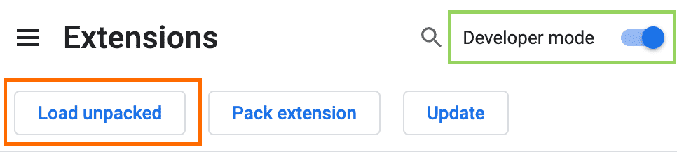
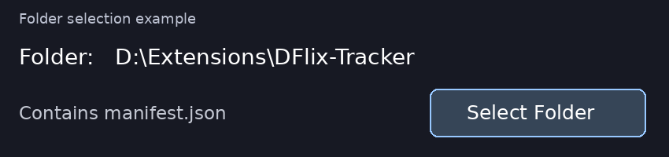
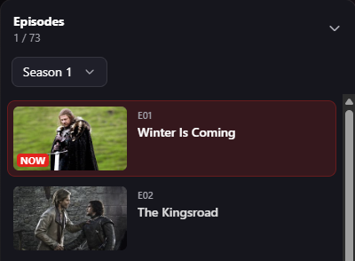

# DFlix Episode Tracker

Save your place in a DFlix series and return to it with **Continue**. The extension remembers the season and episode for each series. On supported players, it also saves the playback position. Progress stays in your Chrome profile.

## Installation

1. Download the extension from this repository using **Code → Download ZIP**. Extract the archive to a permanent folder on your computer.
2. In desktop Chrome, open `chrome://extensions`. Turn on **Developer mode**, then select **Load unpacked**.

   

3. In the folder picker, open the extracted directory that contains `manifest.json` and click **Select Folder**. The folder picker may hide individual files. The path below is an example.

   

4. Refresh any open DFlix watch page. The **Episode tracker** panel appears in the lower-right corner.

## Resume an episode

Select an episode from the DFlix episode list and start playback. The **NOW** label identifies the active episode.

When the tracker displays a time beside the episode number, it has detected the playback position. The next time you open the series, click **Continue**. If the saved episode belongs to a different season, select that season first.

**If only the episode number appears**, open the extension from the Chrome toolbar while the video is playing. When the popup lists an embedded player host, select **Enable** for that host, refresh the watch page, and start playback again. Timestamp support depends on the player.

## Privacy and permissions

The extension stores the series identifier, season, episode, and playback position in Chrome’s local extension storage. It uses no analytics or external account service.

| Permission | Purpose |
| --- | --- |
| Storage | Save progress between viewing sessions. |
| Active tab and scripting | Identify embedded players on the current DFlix watch page and enable the playback helper. |
| Optional host access | Read playback time and resume video on the embedded player host you approve. |

## Updates

Extract the new version into the same installation folder. Open `chrome://extensions`, click **Reload** on the extension card, then refresh the DFlix watch page. Loading the extension from a different folder can create a separate progress history.

This is an independent project and is unaffiliated with DFlix.

Chrome settings screenshot adapted from [Chrome for Developers](https://developer.chrome.com/docs/extensions/get-started/tutorial/hello-world) under [CC BY 4.0](https://creativecommons.org/licenses/by/4.0/).
